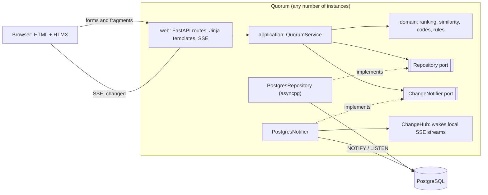
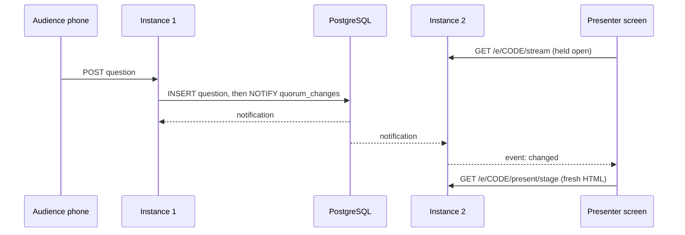

# Quorum

[](https://github.com/mengxie/quorum/actions/workflows/ci.yml)


[](LICENSE)

**Live Q&A for talks, meetups and all-hands. The room asks, votes, and the best questions rise in
real time.**

"Any questions?" usually meets silence, then the loudest voice. With Quorum, the host creates a
session and puts a code (or QR code) on screen. Everyone asks from their phone, anonymously if they
like, and upvotes what they want answered. The host picks a question to answer and the presenter
screen shows it to the room.

## Ideas worth a look

- **Real-time without a JavaScript framework.** Pages are server-rendered HTML (FastAPI + Jinja).
  Each open screen holds a Server-Sent Events stream; when anything changes, the server sends a
  tiny `changed` signal and [HTMX](https://htmx.org) fetches fresh HTML for the part that changed.
  The stream carries a signal, never data, so it can never show something a normal request would not.
- **Many app instances, no Redis.** Changes are broadcast with PostgreSQL `LISTEN/NOTIFY`, so every
  instance behind a load balancer wakes its own connected screens. A test proves a change published
  by one instance reaches another.
- **"Has someone already asked this?"** While you type, a dependency-free TF-IDF similarity engine
  suggests matching questions so you can upvote instead of asking again.
- **Ranking that is fair to late questions.** Sorting by votes alone lets the first questions win
  just by being seen longest. Quorum's "hot" score lets votes count for less as a question ages,
  tuned in minutes for a live session.
- **No accounts.** Participants get an anonymous id in a signed cookie (one vote each). The host gets
  a secret link that is stored only as a SHA-256 hash, shown once, and removed from the address bar
  after use.
- **Works without JavaScript.** Every action is a real HTML form; HTMX only upgrades it.

## Architecture





Dependencies point inwards: `domain` is pure Python with no I/O, `application` depends only on the
domain and two small ports, and `infrastructure` and `web` sit at the edge.

## Run it

```bash
docker compose up --build
```

Open http://localhost:8000, create a session, open the audience link on your phone (or another
browser) and the presenter screen on a second window.

### Develop

With [uv](https://docs.astral.sh/uv/) and Python 3.12:

```bash
uv sync
docker compose up -d db
cp .env.example .env
uv run uvicorn quorum.web.app:create_app --factory --reload
```

| Command                                  | What it does                                  |
| ---------------------------------------- | --------------------------------------------- |
| `uv run pytest`                          | Tests (database tests need `QUORUM_TEST_DATABASE_URL`) |
| `uv run ruff check && uv run ruff format --check` | Lint and formatting                   |
| `uv run mypy src tests`                  | Strict type checking                          |
| `uv run quorum-migrate`                  | Apply migrations as a separate deploy step    |

## Tests

41 tests: the domain (ranking, similarity, codes, validation) as plain unit tests; every use case
against real PostgreSQL; the SSE stream generator; cross-instance fan-out over `LISTEN/NOTIFY`; and
the web layer end to end (security headers, the host-link flow, CSRF refusal, no-JavaScript
fallbacks, the presenter QR code). CI runs them against a PostgreSQL service, enforces coverage,
then builds the Docker image and checks the running stack.

## Security

- Strict Content Security Policy: no inline scripts or styles, and all assets (HTMX, fonts) are
  self-hosted, so the app makes no third-party requests.
- CSRF defence in depth: `SameSite=Lax` session cookies plus an Origin check on every state change.
- Host links are capabilities: hashed at rest, compared in constant time, never sent as a Referer.
- Rate limiting on asking, length limits enforced in both the app and the database.
- Database invariants: for example, a partial unique index guarantees only one question per
  session is ever "now answering".

## Project structure

```
src/quorum/
  domain/          Pure rules: ranking, similarity, join codes, validation, entities
  application/     QuorumService use cases and the Repository / ChangeNotifier ports
  infrastructure/  asyncpg repository, SQL migrations, LISTEN/NOTIFY fan-out
  web/             FastAPI routes, SSE, security middleware, templates, static assets
tests/             Unit, database and HTTP tests
docs/adr/          Architecture decision records
```

## Design decisions

1. [Server-rendered HTML with HTMX instead of a single-page app](docs/adr/0001-htmx-over-spa.md)
2. [Real-time with Server-Sent Events and PostgreSQL LISTEN/NOTIFY](docs/adr/0002-sse-and-listen-notify.md)
3. [A "hot" ranking for live sessions](docs/adr/0003-hot-ranking.md)
4. [Duplicate detection with TF-IDF instead of an ML service](docs/adr/0004-tfidf-duplicates.md)
5. [No accounts: anonymous participants and hashed host links](docs/adr/0005-no-accounts.md)

## Limitations and next steps

- The LISTEN connection does not yet reconnect by itself after a database restart; the health check
  would then need to report it.
- Sessions never expire; a retention job should delete old ones.
- Duplicate detection is English-centric (stopwords and stemming).
- Next ideas: reactions during the talk, an export of answered questions, and moderation before
  questions appear.

## License

[MIT](LICENSE) © Meng Xie
